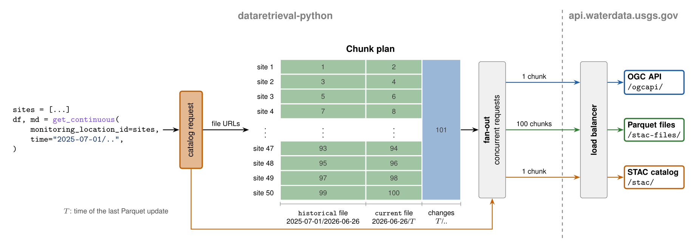

ADR 0014: Read history from the nightly files and changes from the API
=======================================================================

Status
------

Proposed

Context
-------

Since October 2026, USGS publishes the ``daily`` and ``continuous`` OGC
collections a second way: as Parquet files, one set per monitoring location,
written by a nightly job and indexed by the Water Data STAC catalog
(https://waterdata.usgs.gov/blog/api-faster-access/). ``continuous`` has two
files per location, ``historical`` and ``current``. ``historical`` ends 150
days before the night it was last written, and ``current`` starts at the
next value, so ``current`` holds 150 days or more. On 2026-11-23, every
``current`` file sampled had been written that night, and ``historical``
files had been written on dates from 2026-10-26 to that night.

The two sources trade speed for freshness. Paging the OGC API for the full
daily discharge record of 40 Ohio gages took 39.8 s; downloading their files
took a few seconds. But a file is a snapshot. It is usually a day behind the
API, and WDFN says it can be a week behind, so a caller reading only files
misses the newest values and every revision since the snapshot.

The files carry what is needed to close that gap. Every record has the same
``last_modified`` as in the API, and the overlapping records were identical in
value and approval status when compared. A record changed after the file was
written therefore has a larger ``last_modified`` than any record in the file,
and an OGC query can select exactly those changes.

Two facts constrain the result's shape. ``daily_id`` and ``continuous_id`` are
random version-4 UUIDs (checked against hashes of ``time_series_id`` and
``time``). They are stable, and each resolves as the record's item in the OGC
API, but they hold no data and the files omit them, so a row read from a file
cannot carry one. And a ``last_modified`` query sees changes but not removals.

Decision
--------

**Add bulk getters that always read the files.** A public package,
``waterdata.bulk``, has ``get_daily`` and ``get_continuous``. Each answers every
query from the files plus the API's changes, and its signature lists only the
arguments the files can answer: ``monitoring_location_id``, required because
the files are published per location; ``time``; the filters below; and
``skip_geometry``. Any other argument is a ``TypeError`` at the call. The
result has the columns and types of ``waterdata.get_daily`` and
``waterdata.get_continuous``, less the record id (below). ``bulk.get_urls``
lists the files for a Parquet reader of the caller's own. The bulk getters
change no existing call.

**Let the existing getters choose the path with a setting.** The Water Data
adapter gains a ``bulk`` setting (ADR 0011), ``"off"`` or ``"auto"``, set with
``WaterdataConfiguration(bulk=...)`` or in the ``[waterdata]`` table of the
configuration file. Under ``"auto"``, a router sends a large query the files
can answer to the bulk getters' files route, and every other query to the
API. ``get_daily`` and ``get_continuous`` keep their signatures. The default
is ``"auto"``, which lands in a major release because it removes the record
id from most ``get_daily`` and ``get_continuous`` results. ``"off"`` keeps
the API path and the record id.

The choice is a setting because it changes how a query runs, not what it
asks for, like ``parallel_chunks`` and ``api_version``. A keyword would add
a parameter to two signatures that most callers should never set: with
``"auto"`` as the default, the router decides. A caller who wants the files
for every query calls the bulk getters, so the setting has no mode for that.
Like ``api_version``, it has no environment variable (ADR 0011 refuses one
for adapter-only settings).

**The files route is private to** ``waterdata.bulk``, in
``bulk/_retrieval.py``. The bulk getters build their arguments as the API
getters do and hand them to its two entry points: ``parse``, which makes a
``Query``, and ``read``, which answers it. The router,
``waterdata/_routing.py``, calls the same two. An import contract keeps
``waterdata.bulk`` from importing the router or the API getters, so the
package can be released without them. Nothing in ``_retrieval`` is public,
so its plan, merge, and file handling can change without a deprecation. What
differs between ``daily`` and ``continuous`` (the id column, the accepted
filters, a date or a timestamp ``time``, the ``historical`` file, the API's
limit on ``time``) is one table in that module, and the terms of the row
estimate are one table in the router. Both collections return each
location's point, which the file rows take from its catalog item.

**The files route returns no record id, and under** ``"auto"`` **neither
does the API.** ``daily_id`` / ``continuous_id`` is not in the files, so a
bulk getter's result has none. Under ``"auto"`` it is left out whether the
files or the API answered, unless ``properties`` names it (as ``id`` or by
its column name). A column filled only for the rows changed since last night
is of no use to a caller, and the columns would otherwise depend on how many
locations the query named, or on an argument such as ``max_rows`` that only
the API accepts. ``(time_series_id, time)`` identifies a record in both.
``"off"`` changes nothing.

**The metadata describes the caller's query, not the requests that answered
it.** The API path already reports a query it splits that way: ``md.url`` is
the unsplit request, ``md.query_time`` the sum of every request's time, and
``md.header`` the headers reporting the lowest remaining quota. The files
path does the same over the catalog search, the downloads, and the change
query, with the URL the API getter sends for the same arguments, so ``md``
does not say which path answered. With a separate files key, the lowest
remaining quota may be that key's.

**A snapshot plus its changes.** For the requested monitoring locations:

1. Search the catalog for their files. ``waterdata.catalog.search`` splits
   the identifiers across searches that each fit the edge firewall's URL
   limit, and runs them as chunks of one fan-out.
2. Download every file as one fan-out chunk (ADR 0008), and read only the rows
   matching the query's stable filters and ``time``. ``historical`` is skipped
   when ``time`` starts within the last 120 days.
3. Take each location's snapshot time ``T`` as the largest ``last_modified``
   in its files. Read it from the row-group statistics, and floor it to the
   day as a margin. For ``continuous``, take the ``current`` file's.
   Because ``T`` comes from the file, the path does not assume how far the
   files are behind. ``historical`` holds only old records, so its newest
   change can be months older than the night it was written, and a
   ``current`` file older than its ``historical`` (a cached copy) lacks the
   changes since its own snapshot. This rule depends on ``historical``
   being rewritten the night after one of its records changes: on
   2026-11-23, no record in the range of five older ``historical`` files had
   changed in the API since the file was written.
4. Send one OGC query whose CQL-text filter has a top-level ``OR`` clause
   per cutoff day and group of locations,
   ``monitoring_location_id IN (...) AND last_modified >= T``,
   plus one clause asking for the whole query for any location without a
   usable file. Where a location's ``current`` file starts more than 12
   hours after its ``historical`` file ends, one more clause asks for every
   record between them. Two files written on different nights leave that
   span in neither, and its records have not changed, so no change clause
   returns them. A gage that recorded nothing there costs an empty answer.
   The OGC chunker splits a filter at top-level ``OR`` and fans the pieces
   out under the concurrency cap, so the path asks it for one request per
   clause and needs no second fan-out mechanism. It asks with a per-call
   chunk count, and a larger ``parallel_chunks`` setting still applies; the
   library does not enter the caller's configuration to route its own
   request. The API's time to answer a
   change clause grows with the locations it names (cold, 2026-11-24: 100
   gages took 12.1 s as one request and 1.2 s as ten), so the change clauses
   are sized for up to 8 requests, then 10 locations each, but no more
   requests than the concurrency cap, since the rest would wait their turn
   and add only quota. A clause names at most 100 locations.
5. Concatenate, and keep the API's version of every ``(time_series_id,
   time)`` present in both.

The ``continuous`` collection refuses a ``time`` argument with an open start
or a span over 1,100 days (HTTP 400), whatever the filter. It accepts a query
with no ``time``, and a filter can compare ``time`` itself. So when the
query's ``time`` is over the limit, step 4 sends none, and every clause
carries the bounds as comparisons instead.

A ``daily`` change query sends no ``time`` at all, and only the clause for
locations without a file carries the bounds. With the query's window, the API
took up to 9 s cold to answer a change query that returned few rows; without
it, 2 to 6 s. The rows outside the window are dropped before step 5, which
would otherwise keep them. Measured cold on 2026-11-24, each run on
never-queried sites with its own window, the daily files path was faster
without the window in 5 of 7 query shapes (for 25 gages over 5 years, 4.6 s
instead of 10.3 s), the same in 1, and 2 s slower in 1 (30 gages over 10
years). ``continuous`` keeps its window: without one, its change query took
11 to 14 s or timed out, against 2 to 7 s with it.

Steps 4 and 5 are the downloads' ``finalize`` hook, so resuming an
interruption (``exc.call.resume()``) returns the whole result. Whichever step
was interrupted, ``exc.call`` is the downloads, and ``exc.partial_frame``
holds the rows of the files read so far, raw as on the API path: the
snapshot's values, before the merge and the ``approval_status`` and
``method_category`` filters. A file that
answers 404 is treated as missing and its location gets the whole query; any
other error on a file is raised.

      2025-07-01, and under it a catalog request that returns Parquet URLs.
      Then, left to right: the chunk plan, with one row per monitoring
      location and columns for the historical file, the current file, and the
      records new since T, above a time axis; the fan-out;
      a dashed line between dataretrieval-python and api.waterdata.usgs.gov;
      the load balancer; and the STAC catalog, Parquet files, and OGC API
      endpoints. The catalog request runs through the fan-out to the STAC
      catalog. Chunks 1 to 100, two per location, go to the files, and chunks
      101 to 108, up to seven locations each after T, go to the OGC API.
   :width: 100%

   One ``get_continuous`` call for 50 monitoring locations. The catalog
   request goes through the fan-out to the STAC catalog and finishes before
   any chunk starts; the Parquet URLs it returns are what the chunk plan is
   built from. Chunks 1 to 100 read the files up to ``T``, and chunks 101 to
   108 ask the OGC API for every record changed since, up to 7 locations each:
   step 4 splits the change query into at most 8 requests. Every request goes
   to the same load balancer, which routes it by path. The plan shows
   locations 1 to 4, 49, and 50, and its column widths follow the time axis;
   the new column holds a few days, so it is drawn as wide as its label. The
   figure's source is ``0014-cloud-optimized-architecture.tex`` in this
   directory.

**Filters are classified by whether a record can change them.**
``parameter_code``, ``statistic_id``, ``time_series_id``, and
``unit_of_measure`` are fixed when a record is written, so they are applied
while reading the files and sent with the change query.
``approval_status`` and ``method_category`` can change after a record is
written, so the change query does not send them, and the merge applies them.
Otherwise a file row that was Provisional at the snapshot and is Approved now
would be returned for ``approval_status="Provisional"``. The change query
would never fetch the Approved version, so nothing would replace it.

**A bulk getter rejects what the files cannot answer before any request.**
Its signature holds only the arguments the files route accepts, and a test
pins the two together. An empty ``monitoring_location_id`` or a duration in
``time`` raises ``ValueError``.

**``"auto"`` chooses per query, without a request.** A query the bulk
getters could not take goes to the API: one without
``monitoring_location_id``, or with ``filter``, ``properties``, ``max_rows``,
``convert_type=False``, a duration in ``time``, or ``method_category`` for
``daily``. Otherwise the router estimates the rows
the API would page through, as locations x series x values per day x days,
and reads the files when that exceeds a base (5,000 rows for ``daily``,
10,000 for ``continuous``) plus a per-location
download cost: 100 rows' worth for a daily or ``current`` file, 10,000 for a
``historical`` one. The series count comes from ``parameter_code`` and
``statistic_id`` (2 for daily and 3 for continuous when neither is given),
and an open-ended ``time`` counts as a typical record (40 years daily, 20
continuous). The estimate can be wrong. The rule is tuned so that a wrong
choice costs at most a second or two, while the right one saves minutes on
large pulls. The ``daily`` base is low because the estimate is severalfold
short for a location with many series, where paging the API took 4.6 s
against 1.8 s for the files (one location, 5 years, 24,000 rows, cold on
2026-11-24); for a single-series gage just over the base, the files were
0.3 s slower. The estimate does not count the change query's rows, which
grow with the files' age.

The constants come from a benchmark run on 2026-11-22 against the live
services. It drew fresh monitoring locations for every run, so that no run
was served from a cache warmed by another: 31 query shapes, two runs each,
for both paths, over 1-100 locations and 7 days to the whole record. Paging
cost about 1 s per 8,000-12,000 rows. The files cost about 2 s, plus a little
per file. The rule picked the faster path in 29 of the 31 shapes. The two
misses cost 0.1 s and 0.4 s. In a holdout of 7 new shapes over other states,
it picked the faster path every time. Measured extremes:

=============================================  ========  =======
Query                                          API       Files
=============================================  ========  =======
1 location, 1 year daily                       0.8 s     1.9 s
100 locations, whole daily record              304.5 s   9.7 s
25 locations, 60 days continuous               23.0 s    5.7 s
1 location, 7 days continuous                  1.0 s     2.1 s
=============================================  ========  =======

``"auto"`` is the default.

**pyarrow is an optional extra,** ``dataretrieval[pyarrow]``, imported only on
the files route. Without it, a bulk getter raises ``ImportError`` naming the
install command, before any request. A query the setting sends to the files
pages the API instead and emits a ``UserWarning`` that names the install
command. A setting can come from a shared configuration file, and a missing
optional dependency should not turn a working call into a failure. The exception is a
``continuous`` ``time`` the API refuses (over 1,100 days, or an open start):
only the files can answer it, so it raises ``ValueError`` naming the install
command and the shorter ``time`` before any request.

Consequences
------------

- For the 40-gage pull above, the files route returned the same 421,785 rows,
  values, columns, and types in 10.6 s instead of 39.8 s. One site's
  continuous discharge since 2025 took 3.1 s instead of 5.9 s. A short query
  for one location gains nothing, which is why ``"auto"`` routes it to the
  API.
- A bulk getter's result has no ``daily_id`` / ``continuous_id`` column.
  Under the default, neither has any ``get_daily`` or ``get_continuous``
  result, including the small ones the router sends to the API, unless
  ``properties`` names it. A caller that needs the id names it in
  ``properties`` or sets ``"off"``.
- The bulk getters and their files route can be released alone, in a minor
  release, because they change no existing call. The setting and its
  ``"auto"`` default need a major release.
- A point read from the files comes from the catalog, which rounds
  coordinates to 9 decimal places: under a millimeter from the API's, but
  not equal to it.
- A record removed from the API since the files were written is still
  returned, until the files are next written. Every case seen so far is the
  trailing edge of a rolling window: Provisional daily values drop out after
  three years, and some series keep only 120 days. Files written before the
  window moved still hold the day or two that dropped off. Against freshly
  written files, the results were identical.
- The path depends on behavior USGS has not documented as a contract: the
  file URL layout, the ``current`` / ``historical`` split and its 150-day
  boundary, ``last_modified`` in the files matching the API,
  ``historical`` being rewritten the night after one of its records changes,
  and the API accepting a ``continuous`` query with no ``time``.
- Each file and each catalog page counts as one request against the API
  key's hourly count. The OGC API, the catalog, and the files share one
  count, with different ceilings: 1,000, 4,000, and 10,000 requests an hour
  on 2026-11-23. The change query runs after every download, so a pull of
  about 1,000 files under one key leaves it no OGC requests for the rest of
  the hour. WDFN recommends a separate key for the files, so the package
  gains a second credential, ``files_api_key`` (``API_USGS_FILES_PAT``). The
  ``credentials`` leaf sends it in place of ``api_key`` on requests under
  ``/stac-files/`` and ``/stac/``, and falls back to ``api_key`` when it is
  unset. Catalog searches use the files' key, as WDFN suggested, so the only
  request this path sends under ``api_key`` is the change query. The cost:
  once the files' key has made 4,000 requests in an hour, the catalog's
  ceiling, the next query's search is refused, before any download. Like
  ``api_key``, it is package-wide and no adapter setting (ADR 0010).
- ``get_ratings``, ``bulk.get_urls``, and the files route share one catalog
  search, ``waterdata.catalog.search``, which alone knows the edge's URL
  limit. It is a module of ``waterdata`` beside ``bulk``, because
  ``get_ratings`` searches the catalog too.
- The configuration guide used ``bulk`` as its example profile name
  (``[waterdata.bulk]``) from v1.3.0. TOML refuses a key and a table with
  one name, so a file with that profile cannot also set ``bulk`` in its
  ``[waterdata]`` table; it can still set it inside the profile or in code.
  The guide's example is now ``overnight``, so a new reader does not copy
  the collision. ADR 0011 is accepted and stays as written.

Alternatives considered:

- **The bulk getters alone, without the setting.** Existing calls would not
  get the faster path, and a caller would need to know the bulk getters
  exist. The setting lets a later default speed up existing calls without a
  change to any import.
- **The setting alone, with an** ``"always"`` **mode** that read the files for
  every query and raised ``ValueError`` for one they could not answer, as
  first implemented. Its getters' signatures listed every API argument, most
  of which it refused, and it put a mode into the configuration file that
  turns a working call into a failure.
- **Getters named** ``get_bulk_daily`` **and** ``get_bulk_continuous`` **in**
  ``waterdata``. A package lets the bulk getters keep the API getters' names,
  and gives them and ``get_urls`` one namespace.
- **A ``bulk`` keyword on both getters** (``bool | "auto"``), as first
  drafted. It puts a choice most callers should leave to the router into
  both signatures, and it makes a script opt in call by call instead of
  once in the configuration file.
- **A ``source=`` keyword.** *Source* is a core term (ADR 0013), naming where
  a setting's value came from, and one spelling binds identifiers too.
- **An Iceberg or DuckLake catalog over the files, built outside USGS.** The
  files are rewritten in place each night, so a catalog's per-file statistics
  go stale. In a test, a filtered Iceberg scan of a rewritten file returned
  no rows instead of 300. Such a catalog is correct only if the job that
  writes the files commits it.
- **Trimming file rows to each series' ``begin`` from
  ``get_time_series_metadata``.** The metadata lagged the API by a day too,
  and it cannot express a Provisional span that drops out in the middle of a
  series.

Follow-up work, not part of this decision:

- Ask WDFN to confirm the retention rules (which records expire, when, and
  whether the files and the API cut over at the same moment). With those
  rules, a short full query around each window edge would remove the extra
  rows.
- Ask WDFN to confirm the URL layout and the file-generation behavior as a
  stable contract.

Compliance
----------

- ``tests/waterdata_bulk_test.py`` (offline) calls the bulk getters and pins
  the merge rule (the API wins), the classification of filters, the
  OR-clause change query and its split into requests, the whole-query clause
  for locations without a file, the cutoff from the ``current`` file, the
  clause for a gap between the two files, a ``time`` over the API's limit
  left out of the change query, the daily change query without ``time`` and
  the rows outside it dropped, the ``historical`` skip, column types when no
  record changed, chunked catalog searches and change clauses, the 404-only
  fallback, resume returning the whole result, every rejection, the
  ``ImportError`` without pyarrow, and each getter's signature against the
  arguments the files route accepts.
- ``tests/waterdata_routing_test.py`` (offline) pins the routing rule's
  eligibility and size decisions, the record id under ``"auto"`` and
  ``"off"``, and the pyarrow fallback and its warning.
- The ``waterdata-bulk`` contract in ``.importlinter`` keeps
  ``waterdata.bulk`` from importing the router or the API getters.
- ``test_live_bulk_matches_the_api`` (``live`` marker, scheduled run) compares
  each bulk getter with its API getter under ``bulk="off"``. It checks rows,
  values, columns, and types, less the id column. A failure there means one
  of the undocumented behaviors above has changed.
- ``test_live_file_layout_is_unchanged`` (``live``) reads the footers of
  three files with range requests and checks the layout a range-request
  reader would rely on: rows sorted by ``time`` in row groups of 50,000, and
  UTC ``last_modified``. Nothing in the current read path depends on it.
- ``tests/configuration_test.py`` pins the setting: ``"auto"`` by default,
  read from code and the ``[waterdata]`` table, validated, and refused from
  the environment. It also pins ``files_api_key``: sent only under
  ``/stac-files/`` and ``/stac/``, never to another host, and ``api_key``
  when unset.

Notes
-----

- #476 implements this decision, with ``waterdata.bulk.get_urls`` and the
  shared catalog search.
